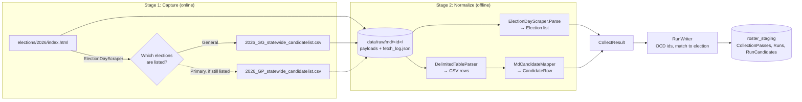

# One state, end to end: Maryland

A companion to [`workflowMap.md`](workflowMap.md). That document maps the whole repo to the workflow. This one follows a single state, Maryland (MD), through one run, file by file and step by step, so you can see what the collector, the selectors, the mapper and the shared code each do.

MD is a good example because it is small but complete. It has every standard file in a state folder, a scraper for finding elections, both config files (`date_formats.json` and `candidate_field_map.json`), and it uses the shared `StateCollectorBase`. Snapshot as of 2026-10-08 (branch `raw-capture`, including the uncommitted move of collectors onto `StateCollectorBase`).

---

## 1. The 30-second version

Maryland's State Board of Elections publishes two things the pipeline uses:

1. A **yearly landing page** (`elections/2026/index.html`) that lists "Primary Election Day" and "General Election Day" with their dates.
2. One **statewide candidate list CSV** per election (`2026_GG_statewide_candidatelist.csv` for the general).

A run downloads the landing page, works out which elections are listed, downloads one CSV per election, and saves everything to disk. It then reads those saved files back, turns each CSV row into a standard `CandidateRow`, and stores the rows grouped under their election.



---

## 2. The cast: every file Maryland uses

### Maryland's own files

| File | What it does, in plain words | Code or config? |
| --- | --- | --- |
| [`MdSourceConfig.cs`](src/StateBallot.States.Md/MdSourceConfig.cs) | Builds the two URLs from the year. For the CSV it also picks the folder and prefix: `primary_candidates`/`GP` or `general_candidates`/`GG`. | Code |
| [`MdSelectors.cs`](src/StateBallot.States.Md/MdSelectors.cs) | Two regexes. `ElectionDayLabel` finds "Primary Election Day" / "General Election Day" on the landing page. `MailingCityStateZip` splits "Bowie MD 20721" into city, state and zip. | Code |
| [`ElectionDayScraper.cs`](src/StateBallot.States.Md/ElectionDayScraper.cs) | Reads the landing page and returns the list of elections. Used in **both** stages: during capture, to decide which CSVs to download; during normalize, to rebuild the same list from the saved page. | Code |
| [`MdCollector.cs`](src/StateBallot.States.Md/MdCollector.cs) | The conductor. `CaptureAsync` says what to download. `NormalizeCore` says how to read it back. Also lists the sources used, for the manifest. | Code |
| [`MdCandidateMapper.cs`](src/StateBallot.States.Md/MdCandidateMapper.cs) | Turns one CSV row into a `CandidateRow`, and builds an `Election` from a label and a date. This is where the field-by-field decisions live. | Code |
| [`MdPublishSchedule.cs`](src/StateBallot.States.Md/MdPublishSchedule.cs) | Says when to run again. For MD it is always "January 1st next year". | Code |
| [`data/input/md/date_formats.json`](data/input/md/date_formats.json) | Date formats the landing page uses: `"MMMM dd, yyyy"`, `"MMMM d, yyyy"`. | **Config** |
| [`data/input/md/candidate_field_map.json`](data/input/md/candidate_field_map.json) | Which MD column holds each simple field, e.g. `"Phone": "Public Phone"`. | **Config** |
| [`data/input/md/sources.json`](data/input/md/sources.json) | **Output**, not input. Rewritten on export with the URLs used and their hashes. | Output |
| [`MdCandidateMapperTests.cs`](src/StateBallot.States.Md.Tests/MdCandidateMapperTests.cs) | Offline tests for the mapper, using hand-built rows. | Test |

### Shared code Maryland leans on

| Shared piece | What it does for MD |
| --- | --- |
| [`StateCollectorBase`](src/StateBallot.Core/StateCollectorBase.cs) | Reads the `[StateCode("MD")]` label, finds `data/input/md/`, loads the two JSON files the first time they are used, and wraps `Normalize` with the empty-result guard, sorting and the next-run hint. |
| [`CollectorDiscovery`](src/StateBallot.Core/CollectorDiscovery.cs) | Finds `MdCollector` by its `[StateCode("MD")]` label, so nothing has to register it by hand. |
| [`HttpFetcher`](src/StateBallot.Core/HttpFetcher.cs) | Downloads with throttling and 3 retries. Every download is passed to the `RawSink`. |
| [`RawSink`](src/StateBallot.Core/Raw/RawSink.cs) / [`FetchTag`](src/StateBallot.Core/Raw/FetchTag.cs) | Saves each payload with a label (role + keys) in `fetch_log.json`. |
| [`CaptureReader`](src/StateBallot.Core/Raw/CaptureReader.cs) | Finds a saved payload by its label and checks its SHA-256 before handing it over. |
| [`DelimitedTableParser`](src/StateBallot.Core/DelimitedTableParser.cs) | Parses the CSV into rows keyed by column header (case-insensitive). |
| [`DateParsing`](src/StateBallot.Core/DateParsing.cs) | Parses "November 3, 2026" using the formats in `date_formats.json`. |
| [`CandidateFieldMapper`](src/StateBallot.Core/CandidateFieldMapper.cs) | Applies `candidate_field_map.json`: looks up the column, trims it, turns blank into null. |
| [`ScrapeGuard`](src/StateBallot.Core/ScrapeGuard.cs) | Fails loudly if the landing page yields no elections (the markup probably changed). |
| [`ResultWriter`](src/StateBallot.Core/ResultWriter.cs) / [`OcdDivisionId`](src/StateBallot.Core/OcdDivisionId.cs) | Converts rows to their stored shape and works out each row's OCD division id. |
| [`ElectionMatcher`](src/StateBallot.Staging/ElectionMatcher.cs) / [`RunWriter`](src/StateBallot.Staging/RunWriter.cs) | Assigns each candidate to its election and writes the pass to the database. |

---

## 3. One run, step by step

Command: `--state MD --year 2026` (capture, then normalize).

### Step 0: Startup (shared, not MD-specific)

1. [`CollectorRunner`](src/StateBallot.Staging/CollectorRunner.cs) checks `state_catalog.json` says MD is implemented.
2. `CollectorDiscovery` finds the class marked `[StateCode("MD")]` and creates `MdCollector(2026, …)`.
3. The `StateCollectorBase` constructor reads the state code, works out the input folder (`data/input/`), and sets up lazy loading of `md/date_formats.json` and `md/candidate_field_map.json`. Nothing is read from disk until a step needs it.

### Step 1: Capture (online)

[`MdCollector.CaptureAsync`](src/StateBallot.States.Md/MdCollector.cs#L25-L32):

```
GET elections.maryland.gov/elections/2026/index.html        tag: elections-page
    → ElectionDayScraper finds <dt>General Election Day</dt><dd>November 3, 2026</dd>
GET .../2026/general_candidates/2026_GG_statewide_candidatelist.csv   tag: candidate-list {type: General}
```

Things worth knowing:

- **MD hides past elections for us.** Once an election has passed, MD comments its block out of the page, so after the June primary only "General Election Day" is still found. MD needs no "skip past elections" logic, unlike WA, CA and TX.
- **Capture already parses the landing page.** It has to: the list of CSVs to download depends on which elections the page lists. So a broken selector fails at capture time, not just at normalize time.
- **The tag is the contract between the two stages.** Capture saves the CSV as `candidate-list {type: General}`; normalize asks for exactly that tag. The `type` value comes from the regex group (`Primary` or `General`).
- Result on disk: `data/raw/md/<capture id>/` with two payload files and `fetch_log.json` (URL, status, size, SHA-256, tag for each).

### Step 2: Normalize (offline, can be re-run)

[`MdCollector.NormalizeCore`](src/StateBallot.States.Md/MdCollector.cs#L34-L73) reads only the capture folder:

1. **Rebuild the election list.** `capture.Require("elections-page")` returns the saved HTML. `ElectionDayScraper.Parse` runs again and `MdCandidateMapper.ToElection` produces:

   | Field | Value | From |
   | --- | --- | --- |
   | `ElectionId` | `2026-general` | year + regex group |
   | `Name` | `2026 General Election` | year + regex group |
   | `ElectionDate` | `2026-11-03` | the `<dd>` text, parsed with `date_formats.json` |
   | `ElectionType` | `General` | regex group |
   | `Jurisdiction` | `state` | always (statewide list only) |

2. **For each election, read its CSV.** `capture.Require("candidate-list", ("type", "General"))`, then `DelimitedTableParser.Parse`.
   - **Zero rows:** record a gap ("the candidate list may not be published yet. Re-run later.") and mark the election *pending*. The run still succeeds.
   - **Otherwise:** each row goes through `MdCandidateMapper.ToCandidateRow` (see section 4).

3. **List the sources** for the manifest (landing page, each CSV, plus Ballotpedia marked "verification only").

### Step 3: The base class finishes up

[`StateCollectorBase.Normalize`](src/StateBallot.Core/StateCollectorBase.cs) wraps `NormalizeCore`:

- **Empty-result guard:** no candidates at all → throw ("refusing to write hollow outputs. Check https://elections.maryland.gov manually"). MD does not override this.
- **Sort** rows into a stable order, so two passes over the same data compare cleanly.
- **Next run:** `MdPublishSchedule` → `recommended_after: 2027-01-01`.

### Step 4: After the collector (shared)

Back in `CollectorRunner` and `RunWriter`:

1. The SHA-256 of each payload is attached to the source manifest.
2. Each row is converted by `ResultWriter.ToCandidateOut`, which also works out its **OCD division id** (section 5).
3. `ElectionMatcher` places each candidate under an election. MD rows carry no source election id, so the match is **by date**; if two MD elections ever fell on the same date, **type** breaks the tie.
4. `RunWriter` stores one `CollectionPasses` row, one `Runs` row per election, and the candidates in `RunCandidates`. Anything that couldn't be matched goes to `PassUnassignedRows`.

---

## 4. Field by field: from MD's CSV to `CandidateRow`

This is the heart of "header mapping" for MD. The **How** column shows whether a field is config (editable in `candidate_field_map.json`) or code (in `MdCandidateMapper`).

| `CandidateRow` field | MD column(s) | How | Notes |
| --- | --- | --- | --- |
| `Office` | `Office Name` | code | Trimmed, used as-is ("Governor / Lt. Governor"). |
| `District` | `Contest Run By District Name and Number` | code | `"State Of Maryland"` → null (statewide). Anything else kept verbatim ("Legislative District 1A"). |
| `CandidateName` | `Candidate First Name and Middle Name` + `Candidate Ballot Last Name and Suffix` | code | Joined with a space. `FirstName`/`LastName` are **not** filled separately. |
| `Party` | `Office Political Party` | config | |
| `FilingDate` | `Filing Type and Date` | config | Kept raw, e.g. "Regular - 02/24/2026". Not split into type and date. |
| `Email` | `Email` | config | |
| `Phone` | `Public Phone` | config | |
| `Website` | `Website` | config | |
| `MailingAddressLine` | `Campaign Mailing Address` | config | |
| `MailingCity` / `MailingState` / `MailingZip` | `Campaign Mailing City State and Zip` | code | Split by `MdSelectors.MailingCityStateZip`. If it doesn't match, all three stay null; nothing is guessed. |
| `ResidentialCounty` | `Candidate Residential Jurisdiction` | code | " County" suffix removed ("Prince George's County" → "Prince George's"). Baltimore City stays as is. |
| `Status` | `Candidate Status` | config | Filing status ("Active", "Withdrawn"…). |
| `County` | n/a | always null | Statewide list only. |
| `Incumbent` | n/a | always null | Not published in this export. |
| `SourceCandidateId` | n/a | always null | No id in this export, which will make matching harder later. |
| `State`, `ElectionDate`, `ElectionType`, `SourceUrl` | n/a | from the election | Stamped on every row. |

**The rule of thumb:** a field is config when it is "copy one column, trim it". As soon as a field needs splitting, joining, a special value check or a suffix strip, it is code. In MD, 7 fields are config and 6 are code.

---

## 5. A single row, traced all the way

The mapper test [`ToCandidateRow_SplitsMailingCityStateZip`](src/StateBallot.States.Md.Tests/MdCandidateMapperTests.cs#L80-L97) uses this row (only the relevant columns shown):

```
Office Name                              : Attorney General
Contest Run By District Name and Number  : State Of Maryland
Candidate First Name and Middle Name     : Anthony G.
Candidate Ballot Last Name and Suffix    : Brown
Campaign Mailing Address                 : 12138 Central Avenue #671
Campaign Mailing City State and Zip      : Bowie MD 20721
```

| Stage | What happens | Result |
| --- | --- | --- |
| Capture | The whole CSV is saved byte-for-byte, tagged `candidate-list {type: General}` | `data/raw/md/<id>/…csv` |
| Parse | `DelimitedTableParser` reads it as a dictionary keyed by header | `{"Office Name": "Attorney General", …}` |
| Map | `MdCandidateMapper.ToCandidateRow` | `Office = Attorney General`, `District = null`, `CandidateName = Anthony G. Brown`, `MailingCity = Bowie`, `MailingState = MD`, `MailingZip = 20721` |
| OCD id | Office is statewide ("attorney general") | `ocd-division/country:us/state:md` |
| Match | Election date 2026-11-03, only one MD election that day | `Runs` row for the 2026 General |
| Store | `RunWriter` inserts into `RunCandidates` | `OfficeKey`, `PoliticianKey` still empty (matching isn't built) |

---

## 6. OCD division ids for Maryland's offices

`OcdDivisionId.ForCandidate` is shared code that decides from the office name and district. How MD's office names fare:

| MD office / district | What it gets | Why |
| --- | --- | --- |
| Governor / Lt. Governor, Attorney General, Comptroller, US Senator | `state:md` | Statewide office, or no district and no county. |
| Representative in Congress, "Congressional District 3" | `state:md/cd:3` | Recognized as US House with a plain district number. |
| State Senator, "Legislative District 12" | `state:md/sldu:12` | Recognized as state senate; "District 12" counts as a plain number. |
| **House of Delegates**, "Legislative District 1A" | **null** | "House of Delegates" isn't in the list of lower-chamber names, and even if it were, "1A" isn't a plain number. |
| Judges (district is a circuit or court name) | null | Has a district that isn't a mappable division. |

The House of Delegates gap is MD-specific (VA's lower house has the same name). Fixing it means teaching `OcdDivisionId` the name *and* deciding how to write sub-districts like 1A/1B. This is a decision about the data, not just a code change.

---

## 7. What can go wrong, and what you'd do

The two-stage split shows up here: most fixes are "edit, then re-normalize the saved capture" (`--normalize <id> --state MD`), with no new download.

| Symptom | Where it fails | Likely cause | Fix | Re-download? |
| --- | --- | --- | --- | --- |
| "No election day entries parsed from … using pattern …" | Capture (and normalize) | MD changed the landing page wording or markup | `MdSelectors.ElectionDayLabel` | Yes, capture had already failed |
| An election is silently skipped (or the error above, if none parse) | Capture | Date text in a new format | Add the format to `date_formats.json` | Yes, the CSV was never downloaded |
| "Failed to fetch … after 3 attempts" | Capture | The CSV doesn't exist yet (404), or the URL pattern changed | Wait, or fix `MdSourceConfig.StatewideCandidateListUrl` | Yes |
| Gap: "no rows parsed … Re-run later" | Normalize | The CSV exists but is empty | Nothing; run again later | n/a |
| Column comes out null for every row | Normalize | MD renamed a column | `candidate_field_map.json` (config fields) or `MdCandidateMapper` (code fields) | **No**, re-normalize |
| City/state/zip all null for some rows | Normalize | Address in an unexpected shape | `MdSelectors.MailingCityStateZip` | **No**, re-normalize |
| "refusing to write hollow outputs" | Normalize | Every CSV was empty | Check the site by hand | Depends |
| "Capture … has no 'candidate-list' (type=…) fetch" | Normalize | Capture and normalize disagree about tags (a code bug) | Make the role/keys match in `MdCollector` | Usually no |

**A sharp edge worth knowing:** the "Re-run later" gap only covers a CSV that exists but is empty. If MD lists an election day before posting its CSV, the download returns 404, `GetStringAsync` treats that as a failure, and **the whole capture fails**. It does not record a pending election. `HttpFetcher.TryGetBytesAsync` already tolerates a 404 and could be used for this if that's the behavior you want.

---

## 8. What Maryland deliberately leaves out

From the comment at the top of `MdCollector`, plus what the mapper leaves null:

- **Local and county races.** MD publishes them in a separate "all_counties" CSV whose contest column mixes county names and district labels. Assigning each row to its county needs parsing that depends on row order, which hasn't been attempted.
- **Ballot measures.** No MD source has been found.
- **County directory.** Not built.
- **Incumbent, source candidate id, split first/last name, split filing date.** Either not published or not yet split.
- **A real schedule.** `MdPublishSchedule` always says "next January" rather than modelling MD's election calendar.

---

## 9. "I want to change X." Which file?

| You want to… | Edit | Kind of change |
| --- | --- | --- |
| Point at a new URL or folder name | `MdSourceConfig.cs` | Code (would be config once the Links Index exists) |
| Handle a new label on the landing page | `MdSelectors.ElectionDayLabel` | Code |
| Accept a new date style | `data/input/md/date_formats.json` | Config |
| Follow a renamed simple column (party, phone, email…) | `data/input/md/candidate_field_map.json` | Config |
| Change how office, district, name, address or county are worked out | `MdCandidateMapper.cs` | Code |
| Add a new source (e.g. the all_counties CSV) | `MdCollector.CaptureAsync` **and** `NormalizeCore`, with a new tag role | Code |
| Change when MD should be re-run | `MdPublishSchedule.cs` | Code |
| Fix an OCD id for an MD office | `Core/OcdDivisionId.cs` | Shared code, affects all states |

---

## 10. How other states differ from Maryland

MD is one of the simplest. The layout is the same everywhere; what changes is mostly **how elections are found** and **how the data is fetched**:

| Difference | Example states | What it means in the code |
| --- | --- | --- |
| Follow links from an index page to find the files | MT, NM, CO | Capture fetches the index, then fetches each file it finds, each with its own tag keys. |
| Call a state API instead of downloading files | WA | A `*Client.cs` next to the collector; payloads are JSON. |
| Sites behind ASP.NET forms | HI, MS | `Core/WebFormsPostback.cs` posts the form and the response is saved like any other payload. |
| Selectors kept in JSON, not C# | CA, WA | `data/input/<xx>/selectors.json` instead of (or alongside) `XxSelectors.cs`. |
| Election ids fixed in config | NM, SD | `data/input/<xx>/election_ids.json`. |
| Past elections still on the page | WA, CA, TX | The scraper must filter by the capture date (`CaptureReader.AsOf`). |
| Counties, measures, county directory | WA, CA and others | More roles in capture, more row types in the result. |

The pattern from section 3 still holds for all of them: capture saves tagged payloads, normalize reads them back by tag, the mapper produces standard rows, and the shared code takes over from there.
